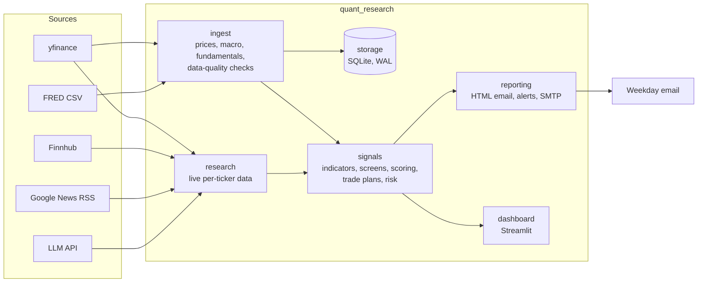

# Quant Research System

[](https://github.com/lUIZhMACEDO/quant-research-system/actions/workflows/ci.yml)

A daily equity research pipeline I built to stop checking tickers by hand. It pulls end-of-day
market data into SQLite, computes indicators, runs five rule-based screens over a watchlist, and
emails me a report every weekday morning. There is also a Streamlit dashboard for looking at a
single name in more detail.

Live dashboard: https://ai-stock-analyst-1.streamlit.app (password protected)

## Quick start

You need Python 3.11 or newer.

```bash
git clone https://github.com/lUIZhMACEDO/quant-research-system.git
cd quant-research-system
python -m venv .venv
source .venv/bin/activate          # Windows: .venv\Scripts\activate
pip install -r requirements-dev.txt
pip install -e .
```

**1. Run the screens on the sample CSV (offline, no API keys).** `examples/sample_prices.csv` is
120 days of synthetic daily prices: a steady uptrend followed by a sharp two-week pullback.

```bash
python -m quant_research analyze examples/sample_prices.csv --ticker SAMPLE
```

Expected output:

```
SAMPLE  last bar 2026-10-15  close 101.81
  RSI(14)      19.2 (OVERSOLD)
  MACD         NEUTRAL
  Bollinger    NEAR LOWER
  EMA 20/50    DEATH CROSS
  Volume       NORMAL
  ATR stop     98.9   ATR target 106.66
  Screen       Bollinger Band Mean Reversion
  Score        +1.5 -> TRIM
  Why          RSI 19 (oversold). Near lower Bollinger band. EMA death cross.
```

The pullback pushes RSI under 30 and price onto the lower Bollinger band, so the mean-reversion
screen fires. The score only uses technicals here because the CSV has no fundamentals or news.
The score-to-label thresholds (above 3 is BUY, above 1 is TRIM, and so on) are in
`signals/scoring.py`. `tests/test_cli.py` checks this exact output, so it stays accurate.

**2. Pull real data for a few tickers into SQLite.** `examples/tickers.txt` lists SPY, AAPL, MSFT
and NVDA. This needs internet access but no API keys, and takes about a minute.

```bash
python ingest.py --tickers-file examples/tickers.txt --only --db example.db
```

Expected output (log lines trimmed):

```
INFO Fetching OHLCV for 4 tickers...
INFO Fetching FRED macro data...
INFO Fetching fundamentals...
INFO Computing private company proxy scores...
INFO Data quality: clean run, no issues.
stored 4 tickers for 2026-11-17, 0 data-quality issues
```

`example.db` then holds about five years of daily bars per ticker (around 1,250 rows each) in
`prices`, the same number of rows in `indicators`, one row in `macro_daily`, and the fundamentals
snapshot. Without `--only` the default universe (index ETFs, sector ETFs and the proxy tickers) is
fetched as well.

**3. Run the tests.**

```bash
pytest
```

All 192 tests should pass in under a minute. None of them use the network.

The dashboard and the email report need credentials. Copy `.env.example` to `.env` and fill in
what you need (see [Configuration](#configuration)).

```bash
streamlit run app.py        # needs APP_PASSWORD
python main.py              # needs the SMTP settings, sends the email report
```

## How it fits together



The `signals` package does the actual math and has no network or disk access: functions take
DataFrames and dicts and return DataFrames and dicts. That is what most of the tests cover. Only
`ingest` and `research` talk to data providers, and `reporting` and `dashboard` just format what
`signals` returns.

There are two data paths. `ingest.py` runs after the close and writes a five-year history into
SQLite. `main.py` and the dashboard work from live provider data for the morning report.

```
src/quant_research/
  config.py       settings read from environment variables
  watchlist.py    portfolio loader, curated picks, rule tables
  cli.py          the analyze / ingest commands
  ingest/         universe, prices, fred, fundamentals, quality checks, pipeline
  storage/        schema.sql (13 tables) and the insert functions
  signals/        indicators, technical snapshot, screens, scoring, trade plans, risk, proxies
  research/       cached market data lookups, per-ticker data, news, portfolio analysis
  reporting/      email HTML, alerts, SMTP, the daily job
  dashboard/      Streamlit app, charts, components, theme
examples/         sample price CSV and ticker list used in the quick start
tests/            pytest suite and small fixture files
app.py, main.py, ingest.py    short entry points (Streamlit Cloud and the workflow call these)
```

## What it does

**Ingest** (`python ingest.py`)

- 5 years of adjusted daily OHLCV per ticker from yfinance.
- 16 FRED series: the Treasury curve (3M to 30Y), 10Y-2Y and 10Y-3M spreads, high-yield and
  investment-grade OAS, the broad dollar index, VIX, unemployment, CPI, M2, fed funds and the 30Y
  mortgage rate, plus derived curve slopes and the HY-IG difference.
- Fundamentals per ticker: trailing and forward P/E, price/book, price/sales, EV/EBITDA, FCF yield,
  ROE, margins, debt/equity, analyst target and rating, short interest.
- Data-quality checks on every series before it is stored: no data, stale last bar, duplicate
  dates, non-positive closes, bars with high below low, and missing values. Problems are written to
  the `data_quality` table.
- Indicators computed over the full series in one pass: RSI-14 and its 252-day z-score, MACD,
  Bollinger bands, SMA 50/200, EMA 20, golden/death cross, ATR-14, 21-day realized volatility,
  5/21/63/252-day momentum, volume z-score, and a Hurst exponent over 64-bar windows as a rough
  trend vs mean-reversion read.
- Inserts skip rows that already exist, so running the same day twice does not duplicate data.

**Screens and report** (`python main.py`)

Five rule-based screens run per ticker: RSI/MACD crossover, Bollinger mean reversion, golden
cross, post-earnings dip, and insider buying. A composite score from -10 to +10 adds up
technicals, valuation, analyst ratings, insider activity and an LLM sentiment score of recent
headlines. Each curated pick gets an entry, stop and target with the stop below the entry, the
target above it, and at least 2:1 reward to risk. The results go into an HTML email sent over SMTP.
A GitHub Actions workflow runs it Monday through Friday.

**Dashboard** (`streamlit run app.py`)

Candlestick charts with Bollinger bands, RSI and MACD panels, sector exposure, risk numbers, and a
portfolio view. The ticker tape and the KPI row refresh on their own without reloading the page.

## What it does not do

- There is no machine learning in this repo. The walk-forward models and the backtester are in
  [trading-bot-ml](https://github.com/lUIZhMACEDO/trading-bot-ml). The screens here are fixed rules.
  The `ml_*` tables in the schema are reserved for that work.
- The private-company exposure scores are a heuristic, not a valuation. They average a few public
  proxy tickers with weights I picked, and the funding-round numbers are whatever was public when I
  wrote them down.
- There is no Tiingo fallback yet. `TIINGO_API_KEY` is reserved for it; prices only come from
  yfinance.
- It does not place orders, and none of it is investment advice.

## Security

Secrets are never stored in the repo. Every credential comes from an environment variable: GitHub
Actions secrets for the daily job, Streamlit Cloud secrets for the dashboard, and a git-ignored
`.env` file locally. `.env.example` lists all of them. The dashboard password used to be written
directly in `app.py` and in the JavaScript of `index.html`. It is now the `APP_PASSWORD` variable,
and the dashboard will not start without it.

Personal data is not stored in the repo either. An earlier version had a sign-up page that
collected visitors' names, emails and holdings into `data/users.json`, which was meant to be
committed to this public repository. I removed it because:

- anything committed to a public repo can be read by anyone, gets picked up by bots that collect
  email addresses, and stays in git history even after the file is deleted;
- there was no consent notice, no way for someone to remove themselves, and no access control;
- GitHub Pages only serves static files, so there is nowhere private to keep a subscriber list.

If I add multi-user reports again, subscriber data will go in a private database with access
control or a mailing-list service with an unsubscribe link, not in git.

A few other things:

- Headlines, company names and user-typed tickers are HTML-escaped before they go into the email
  or the dashboard, and only `http` and `https` links are shown. The report recipient has to be a
  single plain email address, which prevents header injection.
- SQL values are always passed as parameters, and column names are checked against the table
  before a statement is built.
- `index.html` can save `data/master_portfolio.json` through the GitHub API using a token kept in
  the browser. If you use that, make a fine-grained token limited to "Contents: read and write" on
  this one repository. The portfolio file itself is public.

## Configuration

| Variable | Used by | Required |
|---|---|---|
| `SENDER_EMAIL`, `EMAIL_PASSWORD`, `RECIPIENT_EMAIL` | email report | for `main.py` (Gmail needs an app password) |
| `SMTP_HOST`, `SMTP_PORT` | email report | no, defaults to `smtp.gmail.com:587` |
| `APP_PASSWORD` | dashboard | yes |
| `PUBLIC_MODE` | dashboard | no, defaults to `1` (only the "Analyze Stocks" page) |
| `FINNHUB_API_KEY` | analyst ratings, earnings, insider trades, news | no, those sections are left empty |
| `ANTHROPIC_API_KEY`, `ANTHROPIC_MODEL` | LLM sentiment scoring and strategy notes | no, sentiment counts as 0 |
| `DB_PATH` | ingest | no, defaults to `quant.db` |

FRED's public series do not need a key.

## Tests and CI

```bash
pytest
ruff check . && ruff format --check .
```

What the tests cover:

- Ingest parsing: FRED CSVs (including missing values written as `.` and both header formats),
  both column layouts yfinance returns, fundamentals mapping, FCF yield edge cases.
- Data-quality checks: each issue type, including the weekend gap that should not count as stale.
- Signal calculations: indicator columns and math, Hurst on trending vs mean-reverting series, the
  technical snapshot on synthetic up and down trends, every screen, the composite score and its
  limits, trade-plan rules across strategies, position sizing, VaR and beta.
- Storage: table creation, repeated inserts, NaN stored as NULL, unknown columns rejected, and a
  full ingest run with fake data sources.
- Reporting and dashboard: escaping of hostile headlines, alert rules, sending through a fake SMTP
  server, the password screen, and a headless render of all five dashboard tabs.
- The quick-start commands above, run against the files in `examples/`.

`tests/conftest.py` makes any test that tries to reach the internet fail, so the suite cannot
quietly depend on a live API. `.github/workflows/ci.yml` runs ruff and the tests on Python 3.11 and
3.12 on every push and pull request. `.github/workflows/daily-report.yml` is the separate weekday
job that sends the report.

## Notes

Data comes from yfinance, FRED, Finnhub, Google News and CoinGecko, each under its own terms, so
check those before reusing anything. The watchlist and thresholds are mine and are not tuned for
anyone else's risk tolerance.
